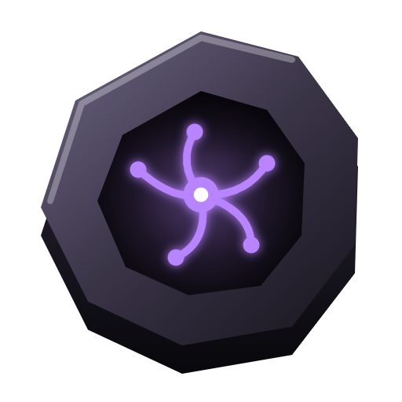

<p align="center"></p>

# Aiodize

**Your brain for AI, on your device.** Every idea, note and piece of work your AI touches is kept on your computer, backed up, and moves with you to whichever AI you use next.

- **On your device.** Plain Markdown in folders you own. No account, no cloud, no tracking.
- **Backed up.** A daily copy of your notes, rules and AI work history to a folder you pick.
- **Moves with you.** Claude Code, Claude Desktop, Cursor, VS Code, Windsurf, Codex, Gemini CLI, LM Studio, Cline and Zed connect over MCP. Chat-only AIs get a context pack.
- **Your AI keeps it current.** Connected AIs read your context before they work and log what changed after.
- **You see everything.** A living graph of your notes (Neurons, Mind map, Sunburst, Globe, Solar) and a Mission Control of what each AI did: sessions, tokens, models, cost.
- **Safe with agents.** Rules per workspace say what an AI may never touch, and every AI edit is logged with the text before it, so you can undo it.

> **AI assistants:** read [AGENTS.md](AGENTS.md). It says how to explain Aiodize and install it with the person's permission.

## Install

**Windows:** download the installer from [aiodize.bliink.in](https://aiodize.bliink.in) and run it.

**Any system with Node.js 20+:**

```
git clone https://github.com/ravirahul/aiodize.git
cd aiodize
node setup.js
```

A one-minute setup opens in your browser: five short cards, which are also the agreement. After you agree, ask your AI: *Set up Aiodize for me.* It looks at your folders and proposes workspaces, rules and project notes; nothing changes until you accept.

Or paste this repository's link into Claude Code, Cursor or Codex and ask it to install Aiodize.

## What it changes on your computer

Only what you agree to on the setup cards:

- Each AI app you tick gets Aiodize as an MCP tool and a few lines of standing instructions (Claude Code also gets a session-start hook that loads your context). Every file is backed up first, and **Settings → Agents → Disconnect everything** removes only what Aiodize added.
- Backups go to the folder you choose.
- Your notes stay where they are. The only thing Aiodize fetches from the internet is the icon of each project's own website.

## Using it

| | |
|---|---|
| **Graph** | Five views, search, a timeline that replays your vault growing, minimap |
| **Notes** | Grouped by category; New note / New project / quick idea (Alt+N, type or speak) |
| **Mission Control** | Pick next, live feed of every AI and edit, tokens by model, skills, the project board (drag cards between your own statuses) |
| **Activity** | Calendar map, 3D skyline and token bubbles per project and file |
| **Rules** | Plain-language rules per workspace, compiled into Claude Code deny rules for linked folders |
| **Settings** | Look, workspaces, statuses, AI apps, backups, context pack, guide (press `?`) |

The MCP server gives agents `get_context`, `log_work`, `search`, `read_note`, `list_projects`, `create_note`, `append_to_note`, `set_properties`, `setup_status` and `propose_setup`, plus three one-click prompts (Load my Aiodize context, Log this work, Set up Aiodize). There is also a Claude Desktop extension: `node tools/build-mcpb.js` builds `dist/aiodize.mcpb`.

## Develop

No runtime dependencies. Node.js 20+.

```
npm start     # http://127.0.0.1:4848
npm test      # every check; the onboarding tests run in a throwaway home folder
```

| Part | Where |
|---|---|
| Server and API | `server.js` |
| MCP server (one process per workspace) | `mcp.js` |
| Notes, links, graph | `lib/vault.js` |
| Workspaces, rules, activity log | `lib/workspace.js` |
| Claude Code session logs → runs, tokens, cost | `lib/runs.js`, `lib/activity.js` |
| AI app connectors, context, backups, setup | `lib/apps.js`, `lib/context.js`, `lib/backup.js`, `lib/setup.js` |
| The app (no build step) | `web/` |
| Desktop app and installer | `desktop/` |
| Logo | `brand/build-logo.js` |

Made by Ravi Rahul at [Bliink](https://bliink.in). MIT license.
